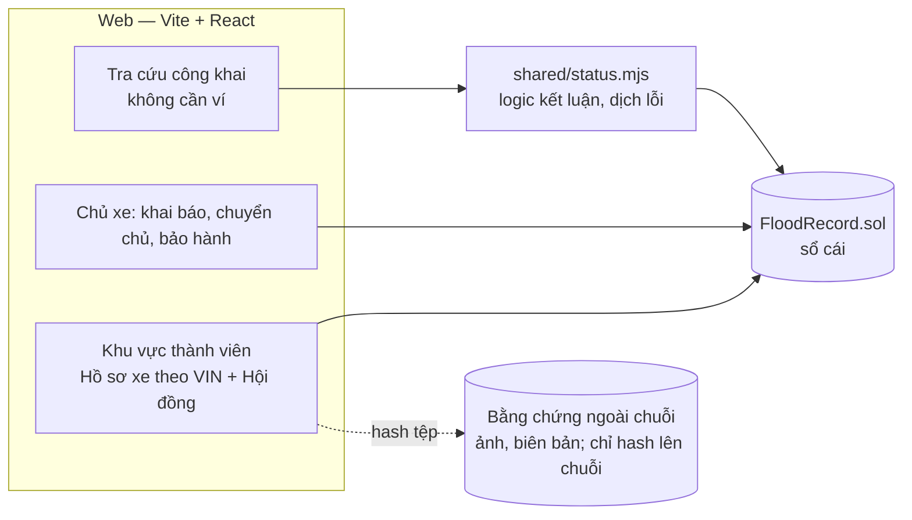

# Kiến trúc hệ thống — Hồ sơ xác thực thông tin xe

Tài liệu giải thích prototype **tra cứu lịch sử ngập nước và thủy kích ô tô theo VIN trên blockchain**: các bên, dữ liệu, luồng nghiệp vụ, quy tắc bất biến, kiểm thử và những chỗ còn hở.

> Trạng thái: prototype chạy trên Hardhat (một node), đã **thu gọn lõi** (2 nhóm thành viên thay cho 4, bỏ lớp "xe đang ở xưởng"), thêm **chuyển chủ** và **thay động cơ**. Mạng Besu 4 node, máy chủ lưu bằng chứng và phương án đối chứng database **chưa làm** (mục 9). Cách chạy: xem [README](../README.md).

---

## 1. Bài toán và nguyên tắc

Người mua xe cũ không biết xe đã từng thủy kích hay bị mở máy hay chưa: bằng chứng nằm rải rác ở hãng, gara, bảo hiểm, đăng kiểm, còn người bán có lợi khi giấu.

1. **Chỉ ghi thêm.** Không có hàm xóa hay sửa sự kiện; sai sót xử lý bằng sự kiện đính chính.
2. **Cờ cảnh báo một chiều.** Ngập, thủy kích, tổn thất toàn bộ, mở máy ngoài hệ thống: đã bật thì không tắt, dù xe đổi chủ, sửa xong hay thay động cơ.
3. **Không bên nào một mình quyết ai được ghi.** Quyền ghi do hội đồng cấp với ≥ 2/3 phiếu.
4. **Hệ thống không phán xử.** Blockchain chỉ chứng minh *ai đã khẳng định điều gì, lúc nào, và không ai sửa lại được*. Nó không chứng minh sự thật vật lý. “Không có ghi nhận” không có nghĩa là xe chưa từng ngập.
5. **Tối thiểu hóa số bên và số thao tác.** Mỗi vai trò, mỗi hàm ghi phải trả lời được: nó chặn được loại gian lận nào mà chi phí vận hành xứng đáng?

## 2. Tổng quan

- **Trên chuỗi:** chủ xe hiện tại, các cờ, tem hiện tại, hash số máy, lịch sử sự kiện (người ghi, thời điểm, hash chứng từ).
- **Ngoài chuỗi:** nội dung chứng từ (ảnh vết nước, ảnh tem, biên bản giám định, phiếu bảo hành), danh bạ tên đơn vị. Chuỗi chỉ giữ hash để ai cũng kiểm tra được chứng từ không bị thay.

## 3. Các bên: từ 5 vai trò xuống 2 nhóm thành viên

| Bên | Trước | Bây giờ | Lý do |
|---|---|---|---|
| Hội đồng | Council | **Council** | Cấp/thu hồi quyền, đổi ngưỡng, ≥ 2/3 phiếu. Không ghi dữ liệu xe (tách quyền cấp phép và quyền ghi). |
| Gara / đại lý | Workshop | **Đơn vị xác nhận** | Ba vai trò cũ khác nhau ở *loại tổ chức*, không khác ở *quyền*. Loại đơn vị là thông tin hiển thị (danh bạ `orgs`), không phải quyền trong hợp đồng. |
| Bảo hiểm | Insurer | **Đơn vị xác nhận** | như trên |
| Đăng kiểm, kiểm tra xe cũ | Inspector | **Đơn vị xác nhận** | như trên |
| Chủ xe | (ngoài vai trò) | Địa chỉ ghi trên hồ sơ xe | Khai báo, chuyển chủ, bảo hành |
| Người mua | Người tra | Người tra | Chỉ đọc, không cần ví |

Việc gộp bỏ được: `custodian`, `checkIn/checkOut`, phiếu tiếp nhận giấy, `issueSeals`, trạng thái tem Issued/Applied/Broken, 4 hàm theo vai trò. Hợp đồng từ 502 xuống còn 385 dòng, 34 lỗi tùy biến xuống 25, 15 loại sự kiện xuống 11.

## 4. Dữ liệu trên chuỗi

- **Khóa xe:** `vinHash = keccak256(VIN chuẩn hóa)`; VIN 17 ký tự, in hoa, bỏ khoảng trắng/gạch nối, không có I, O, Q.
- **Số tem / số máy** chỉ lưu dạng hash (`keccak256("seal:"+số)`, `keccak256("engine:"+số)`), bỏ khoảng trắng và in hoa trước khi hash để nhập tay không lệch.
- **Vehicle:** chủ, 4 cờ một chiều, mức yêu cầu kiểm tra đang mở, tem hiện tại, hash số máy hiện tại, mốc chuyển chủ gần nhất (ngày, số ngày bảo hành, tem lúc chuyển).
- **Record:** loại, người ghi, thời điểm xảy ra/ghi, `sub` (loại phụ), hash chứng từ, `ref` (số tem hoặc hash số máy), `num` (km, chỉ số đính chính, số ngày bảo hành).
- Mỗi số tem chỉ gắn cho **một xe, một lần** (`sealVehicle`), nên tem cũ không quay lại và không dùng cho xe khác.

## 5. Luồng nghiệp vụ

### 5.1 Kết nạp thành viên
Một thành viên hội đồng đề xuất (tính 1 phiếu); đủ 2/3 thì đơn vị được cấp quyền Đơn vị xác nhận. Thu hồi quyền cũng cần 2/3; bản ghi cũ vẫn còn.

### 5.2 Đơn vị xác nhận ghi sự kiện (mọi đơn vị có cùng quyền)

| Hàm | Dùng khi | Hiệu quả |
|---|---|---|
| `registerVehicle` | Đại lý/gara đăng ký xe; tem, số máy có thể bổ sung sau | Tạo hồ sơ |
| `reportFlood` | Bảo hiểm theo hồ sơ bồi thường; gara khi tiếp nhận xe ngập | Bật cờ ngập (và thủy kích nếu loại thủy kích) |
| `declareTotalLoss` | Quyết định bồi thường toàn bộ | Bật cờ tổn thất |
| `inspect` | Đăng kiểm, kiểm tra xe cũ, gara sau khai báo của chủ xe | **Một lần ghi** gồm km, tem đọc được, kết luận (nếu có), tem mới (nếu dán lại) |
| `repairCompleted` | Sửa xong sau ngập | Thêm sự kiện; **không** tắt cờ; kèm tem mới nếu có |
| `changeSeal` | Bảo dưỡng, sửa, mở máy có chủ đích | Đổi tem, ghi lý do chuẩn hóa |
| `changeEngine` | Thay động cơ | Ghi hash số máy mới; cờ không đổi |
| `proposeAmend` | Đính chính sự kiện do chính mình ghi | Chờ thành viên khác ký |

**`inspect` là điểm tối ưu nhập liệu chính.** Trước đây kiểm định, kiểm tra lại, đóng yêu cầu, phá tem và đặt tem là 5 hàm với 5 biểu mẫu; nay là một biểu mẫu:
- Tem đọc được khác tem trên hồ sơ (kể cả không thấy tem) → bật cờ “mở máy ngoài hệ thống”.
- Có kết luận (không ngập / ngập sàn / ngập máy / thủy kích) → đóng yêu cầu của chủ xe, kết luận có ngập thì bật cờ.
- Có tem mới → ghi thêm sự kiện thay tem, lý do tự suy ra: “đã mở ngoài hệ thống” nếu tem lệch, “bảo dưỡng” nếu khớp.

### 5.3 Chủ xe khai báo
`ownerReport(độ ngập, thời gian ngâm, chết máy)` → hợp đồng phân mức 1–3 theo ngưỡng của hội đồng, mở yêu cầu kiểm tra, **không bật cờ**. Yêu cầu đóng khi một đơn vị xác nhận ghi `inspect` có kết luận. Chủ xe chỉ cần đưa xe tới một đơn vị bất kỳ được cấp phép, không còn bước “chọn gara tiếp nhận”.

### 5.4 Chuyển chủ (mua bán, thanh lý)
Một hàm duy nhất `transfer(xe, chủ mới, số ngày bảo hành)` do **chính chủ xe ký**. Dùng chung cho:
- **Bán cá nhân**: người bán ký, chủ mới nhận.
- **Đại lý bán kèm bảo hành**: đại lý đứng tên xe trong kho, ký chuyển cho khách và cam kết bảo hành.
- **Thanh lý xe tổn thất toàn bộ**: bảo hiểm ghi ngập + tổn thất → chủ xe ký chuyển cho bảo hiểm → bảo hiểm ký chuyển cho người mua. Các cờ đi theo xe qua mọi lần chuyển.

Hợp đồng ghi tem hiện tại vào lúc chuyển để so sánh khi có yêu cầu bảo hành.

### 5.5 Bảo hành
Sau mỗi lần chuyển chủ có `warrantyDays`. Chủ hiện tại `claimWarranty` trong hạn; trang tra cứu so tem lúc chuyển với tem hiện tại và nêu sự kiện ngập nằm trước hay sau ngày chuyển.

### 5.6 Thay động cơ
`changeEngine` lưu hash số máy mới. Mục tiêu nghiệp vụ: thay động cơ là cách phổ biến để “xóa dấu vết” thủy kích, nên hệ thống **giữ cờ** và nêu rõ “đã thay động cơ N lần, gần nhất ngày …” trên trang tra cứu.

### 5.7 Đính chính
Bên ghi gốc đề xuất, một thành viên khác ký. Sự kiện cũ vẫn còn, chỉ được đánh dấu “đã đính chính”; cờ không tắt.

## 6. Quy tắc bất biến

| Quy tắc | Cách bảo đảm |
|---|---|
| Không xóa/sửa sự kiện | Hợp đồng không có hàm xóa/sửa (test kiểm tra tên hàm) |
| Cờ một chiều | Mọi hàm chỉ đặt `true`; đính chính, sửa xong, thay động cơ, chuyển chủ không đụng cờ |
| Chỉ hội đồng cấp quyền, ≥ 2/3 | `approvals*3 ≥ councilSize*2`; hội đồng không ghi dữ liệu xe |
| Tem dùng một lần, một xe | `sealVehicle[serial]` |
| Chủ xe khai báo không bật cờ | `ownerReport` chỉ mở yêu cầu |
| Chỉ chủ hiện tại khai báo, chuyển chủ, bảo hành | So `msg.sender` với `owner`; chủ cũ mất quyền sau khi chuyển |
| Lý do “mở ngoài hệ thống” không chọn tay | Chỉ phát sinh qua `inspect` khi tem lệch |
| Thời điểm xảy ra không ở tương lai | `FutureTime` |

## 7. Trang tra cứu

`shared/status.mjs` biến dữ liệu chuỗi thành kết luận, dùng chung cho web và script:
- **Có ghi nhận ngập/thủy kích** nếu có bất kỳ cờ nào.
- **Có khoảng trống** nếu tem trên máy lệch tem hồ sơ, hoặc từng có kiểm tra thấy tem lệch mà **chưa đơn vị nào kết luận lại**, hoặc xe chưa đăng ký.
- **Hồ sơ liên tục** chỉ khi không cờ, tem khớp và có ít nhất một lần kiểm tra.
- **Chưa đủ căn cứ** khi chưa đối chiếu tem hoặc đang có yêu cầu chờ kiểm tra.
- Xe từng mở máy ngoài hệ thống nhưng đã được kiểm tra lại có kết luận → không bị xếp chung với sửa lén; vẫn hiện dòng “đã kiểm tra lại ngày …”.
- Luôn hiện “Hồ sơ bắt đầu từ ngày …” để người mua biết hệ thống không có dữ liệu trước đó.
- Số tem **không** hiển thị công khai (chống làm giả); người dùng nhập số đọc trên máy để hệ thống so.

## 8. Kiểm thử (giới hạn 3 vòng test-sửa)

| Lớp | Kết quả |
|---|---|
| Hợp đồng (`npx hardhat test`) | 35/35, vòng 1 |
| Kịch bản nghiệp vụ (`node scripts/scenarios.js`) | 37/37, vòng 2 (vòng 1 lỗi do hai VIN demo dài 18 ký tự, không do logic) |
| Trình duyệt Edge (`npm --prefix web run e2e`) | 47/47, vòng 2 (vòng 1 lỗi do thông báo chuyển chủ biến mất khi biểu mẫu đóng; đã giữ thông báo ở trang) |

Kịch bản nghiệp vụ gom theo quy trình: người mua tra cứu · chủ xe khai báo · đại lý bán kèm bảo hành · kiểm tra lại sau mở máy · thay động cơ · thanh lý xe tổn thất · kiểm soát quyền.

## 9. Từ prototype tới triển khai thật

Chưa làm: mạng **Besu QBFT 4 node**, **máy chủ lưu bằng chứng** (Express + SQLite; `evidence/store.js` đã có phần lưu/hash), **PostgreSQL** làm phương án đối chứng, đo gas/thời gian, kiểm tra mức chịu tải.

Bằng chứng (ảnh) đã có đường đi: biểu mẫu cho phép đính kèm tệp, **hash tệp** đi vào hash chứng từ trên chuỗi. Nội dung tệp chưa có nơi lưu; khi làm máy chủ bằng chứng sẽ lưu tệp ở đó và nút “Kiểm tra hash” cho phép ai cũng đối chiếu.

## 10. Rủi ro còn lại sau khi thu gọn (cần nói thẳng)

1. **Đơn vị xác nhận có thể ghi cho bất kỳ VIN nào.** Trước đây gara chỉ ghi được cho xe chủ xe ký tiếp nhận. Đổi lại: không còn bước ký tiếp nhận (chủ xe không có ví không còn là chặn), nhưng một đơn vị xấu có thể ghi cờ ngập sai. Giảm nhẹ: mọi sự kiện gắn danh tính đơn vị, hội đồng thu hồi quyền theo 2/3, đính chính cần thành viên thứ hai; hồ sơ ngập sai vẫn nằm đó (cờ một chiều) nên **quy trình khiếu nại ngoài chuỗi** là cần thiết khi triển khai thật.
2. **Giấu thay vì ghi sai.** Hệ thống không ép ai phải ghi. Hai lớp phòng: tem niêm phong (mở máy mà không ghi thì kiểm tra thấy tem lệch) và việc bảo hiểm ghi theo hồ sơ bồi thường. Xe ngập không bồi thường, sửa gara ngoài hệ thống, không dán tem vẫn lọt.
3. **Tem là bằng chứng gián tiếp.** Hệ thống chỉ so số tem; không phân biệt được tem thật bị bóc dán lại. Cần tem tiêu chuẩn tự hủy khi bóc (vấn đề vật lý, ngoài phạm vi code).
4. **Cờ sai không gỡ được** theo đúng thiết kế một chiều; cần thủ tục pháp lý bên ngoài.
5. **Mất ví chủ xe** chưa có cơ chế khôi phục (đã đề xuất, chưa làm).

## 11. Việc tiếp theo

- Phản hồi bảo hành từ bên bán và quá hạn “chưa phản hồi”; phản đối (khiếu nại) gắn vào sự kiện.
- Thang mức ngập chi tiết (mực nước 4 bậc, nước mặn/lợ, động cơ có chạy trong nước hay không), chi tiết để ngoài chuỗi.
- Phân loại đơn vị kiểm tra xe cũ và đăng kiểm (chỉ ghi km) nếu cần quyền khác nhau.
- Khôi phục chủ xe mất ví: một đơn vị đề xuất, thành viên khác xác nhận.
- Máy chủ bằng chứng, Besu, Postgres, đo gas.

## Phụ lục A — Tài khoản và dữ liệu mẫu

Hardhat: tài khoản 0–3 hội đồng; **4 Đại lý A, 5 Gara C, 6 Công ty bảo hiểm B, 7 Trung tâm đăng kiểm D** (cùng vai trò Đơn vị xác nhận); 8–19 chủ xe.

| Xe (VIN giả, tiền tố RLXDEM) | Câu chuyện nghiệp vụ |
|---|---|
| `RLXDEMA0000000123` | Thủy kích, bảo hiểm ghi, Gara C sửa và dán tem mới |
| `RLXDEMB0000000ABC` | Xe sạch, hồ sơ liên tục |
| `RLXDEMC0000WTY001` | Đại lý bán kèm bảo hành 180 ngày |
| `RLXDEMD0000GAP001` | Sửa xong rồi bị mở máy ngoài hệ thống, đăng kiểm thấy mất tem |
| `RLXDEME000SEAL001` | Hồ sơ sạch, dùng để thử tem lạ |
| `RLXDEMF0000REP001` | Chủ xe khai báo ngập, chờ kiểm tra |
| `RLXDEMH000RECHK01` | Mở máy ngoài hệ thống, sau đó Gara C kiểm tra lại, dán tem mới |
| `RLXDEMJ0000ENG001` | Thủy kích rồi thay động cơ |
| `RLXDEMK0000SLV001` | Tổn thất toàn bộ, bảo hiểm nhận xe rồi bán lại |
| `RLXDEMZ9999999999` | Đúng định dạng, chưa đăng ký |

## Phụ lục B — Bản đồ mã nguồn

| Đường dẫn | Nội dung |
|---|---|
| `contracts/FloodRecord.sol` | Hợp đồng lõi |
| `test/FloodRecord.test.js` | 35 test hợp đồng |
| `scripts/deploy.js`, `seed.js`, `scenarios.js`, `lib.js` | Triển khai, dữ liệu mẫu, kịch bản nghiệp vụ |
| `shared/status.mjs`, `shared/demo.mjs` | Logic kết luận dùng chung; dữ liệu minh họa |
| `evidence/` | Hash chứng từ chuẩn hóa, kho SQLite |
| `web/src/Lookup.jsx` | Trang tra cứu công khai |
| `web/src/Owner.jsx` | Chủ xe: khai báo, chuyển chủ, bảo hành |
| `web/src/Staff.jsx` | Khu làm việc theo VIN: nhập một lần, ô việc theo tình trạng xe, đính kèm tệp |
| `web/src/Council.jsx` | Hội đồng: đề xuất, bỏ phiếu |
| `web/e2e/run.mjs` | 47 kiểm tra trên trình duyệt thật |
