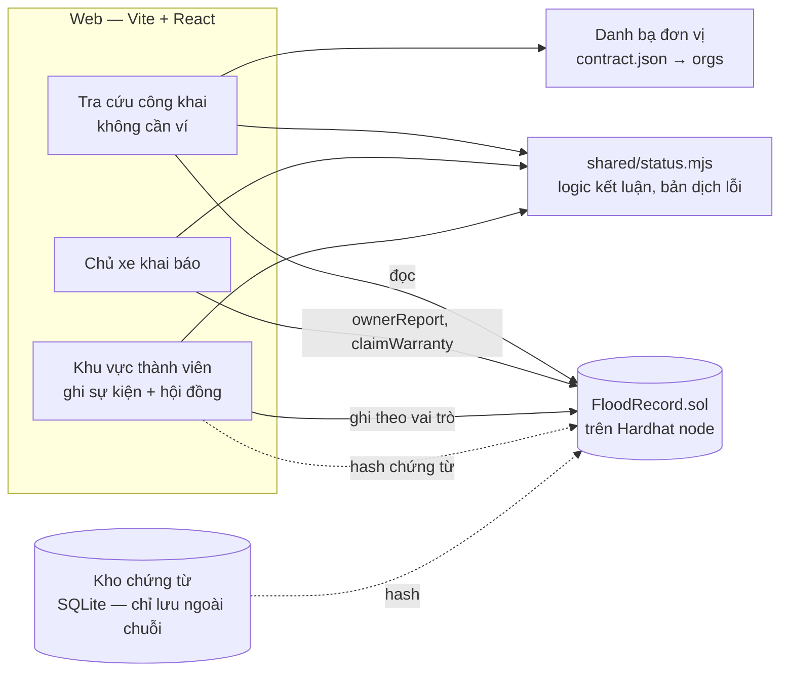
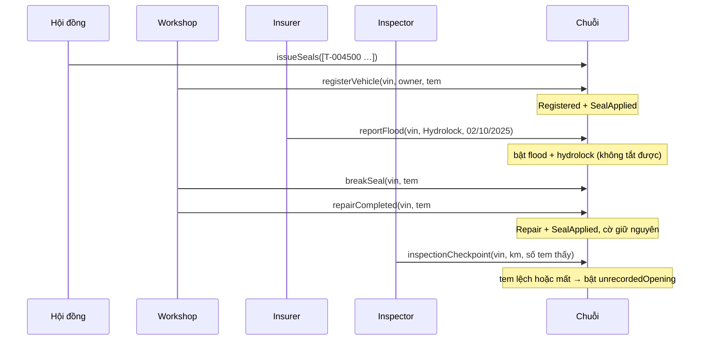

# Kiến trúc hệ thống — Hồ sơ xác thực thông tin xe

Tài liệu giải thích những gì nhóm đã xây cho prototype **tra cứu lịch sử ngập nước và thủy kích ô tô theo VIN trên blockchain**: các thành phần, dữ liệu, luồng nghiệp vụ, quy tắc bất biến, cách kiểm thử, và đánh giá từng phần theo góc nhìn triển khai thực tế của từng bên liên quan.

> Trạng thái: **prototype chạy trên Hardhat (một node)**. Mạng Besu 4 node, máy chủ chứng từ và phương án đối chứng database **chưa làm** — xem [mục 9](#9-từ-prototype-tới-triển-khai-thật).
> Cách cài đặt và chạy: xem [README](../README.md).

---

## 1. Bài toán và nguyên tắc thiết kế

Người mua xe cũ không kiểm tra được xe đã từng thủy kích hay bị mở máy chưa, vì bằng chứng nằm rải rác ở hãng, gara, bảo hiểm — những bên không chia sẻ cho nhau — còn người bán có lợi khi giấu.

Bốn nguyên tắc chi phối mọi lựa chọn bên dưới:

1. **Chỉ ghi thêm.** Không có hàm xóa hay sửa sự kiện. Sai sót được xử lý bằng một sự kiện đính chính trỏ về sự kiện cũ.
2. **Cờ cảnh báo một chiều.** Đã bật thì không tắt; sửa xong chỉ thêm sự kiện "đã sửa".
3. **Không bên nào một mình quyết ai được ghi.** Quyền ghi do hội đồng cấp với ≥ 2/3 phiếu.
4. **Hệ thống không phán xử, không chẩn đoán.** Nó chỉ cho biết những gì đã được các bên có thẩm quyền ghi nhận.

## 2. Tổng quan kiến trúc



| Thành phần | Vị trí | Vai trò |
|---|---|---|
| Hợp đồng `FloodRecord` | `contracts/FloodRecord.sol` | Sổ cái: phân quyền, xe, tem, sự kiện, cờ, bảo hành, đính chính |
| Kiểm thử hợp đồng | `test/FloodRecord.test.js` | 34 test (Hardhat + chai) |
| Script | `scripts/deploy.js`, `seed.js`, `scenarios.js`, `lib.js` | Triển khai + cấp quyền qua 2/3 phiếu; dữ liệu mẫu; chạy tự động các tình huống |
| Logic dùng chung | `shared/status.mjs` | Kết luận tra cứu, nhãn tiếng Việt, dịch lỗi hợp đồng — dùng chung cho web và script |
| Chứng từ | `evidence/hash.js`, `evidence/store.js`, `web/src/evidence.js` | Băm JSON chuẩn hóa; lưu nội dung ngoài chuỗi (SQLite) |
| Web | `web/src/` | `Lookup` (tra cứu), `Owner` (chủ xe), `Members` = `Staff` + `Council` (thành viên), `demo.js` (dữ liệu minh họa) |

**Trên chuỗi** chỉ có: khóa xe dạng hash, trạng thái cờ, tem (dạng hash), sự kiện (loại, bên ghi, thời điểm, hash chứng từ), bảo hành, đề xuất của hội đồng.
**Ngoài chuỗi:** ảnh, biên bản, nội dung khai báo, tên đơn vị. Không lưu tên, số điện thoại, biển số của chủ xe ở bất kỳ đâu.

## 3. Các bên và quyền

| Vai trò | Ngoài đời | Được gọi | Không được |
|---|---|---|---|
| Hội đồng | Đại diện các tổ chức chạy node | `proposeAddMember`, `proposeRevokeMember`, `proposeThresholds`, `approveProposal`, `issueSeals` | Ghi sự kiện về xe |
| Workshop | Đại lý ủy quyền, gara được duyệt | `registerVehicle`, `applySeal`, `breakSeal`, `repairCompleted`, `resolveRequest`, `handover`, `reportFlood` | Tự cấp quyền |
| Insurer | Doanh nghiệp bảo hiểm | `reportFlood`, `declareTotalLoss` | Đặt/phá tem |
| Inspector | Đơn vị đăng kiểm | `inspectionCheckpoint` | Ghi ngập |
| Chủ xe | Địa chỉ ví đang là `owner` của xe | `ownerReport`, `claimWarranty` | Ghi sự kiện hư hỏng, đóng yêu cầu |
| Người tra cứu | Người mua, cửa hàng xe cũ | Mọi hàm `view` (miễn phí, không cần ví) | — |

Bất kỳ thành viên nào (Workshop/Insurer/Inspector) cũng tham gia **đính chính**: bên ghi gốc đề xuất (`proposeAmend`), một thành viên khác ký (`coSignAmend`).

**Hội đồng 2/3.** Mỗi đề xuất được thực hiện khi `số phiếu × 3 ≥ số thành viên hội đồng × 2`. Với 4 thành viên cần 3 phiếu; người đề xuất tự tính 1 phiếu. Không thể thu hồi thành viên hội đồng cuối cùng.

## 4. Mô hình dữ liệu

### 4.1 Khóa và hash

| Đối tượng | Cách tính | Ghi chú |
|---|---|---|
| Xe | `vinHash = keccak256(VIN.trim().toUpperCase())` | Chuẩn hóa ở client (`web/src/lookup.js`, `scripts/lib.js`) |
| Số tem | `keccak256("seal:" + số in trên tem)` | Chuỗi chỉ giữ hash → trang công khai **không hiện được** số tem, người mua phải đọc trên máy |
| Chứng từ | `keccak256(JSON chuẩn hóa)` — khóa sắp xếp, không khoảng trắng | Cùng thuật toán ở `evidence/hash.js` và `web/src/evidence.js` |

### 4.2 Cấu trúc trên chuỗi

- **`Vehicle`**: `owner`, bốn cờ một chiều (`flood`, `hydrolock`, `totalLoss`, `unrecordedOpening`), `openRequest` (mức khai báo của chủ xe đang chờ), `currentSeal`, và thông tin giao xe (`handoverAt`, `warrantyDays`, `sealAtHandover`, `handoverHash`).
- **`Record`** (mảng chỉ thêm theo xe): `kind`, `actor`, `occurredAt` (do người khai), `recordedAt` (`block.timestamp`), `sub` (loại ngập / mức / kết luận / tem lệch), `dataHash`, `seal`, `num` (km, số ngày bảo hành, chỉ số sự kiện bị đính chính).
- **`Seal`**: `None → Issued → Applied → Broken`, kèm `vinHash` của xe đang gắn.
- **`Proposal`** và **`Amend`**: đề xuất của hội đồng và đề xuất đính chính.

12 loại sự kiện: Đăng ký xe, Đặt tem, Phá tem, Ghi nhận ngập, Sửa xong, Tổn thất toàn bộ, Mốc kiểm định, Giao xe, Khai báo của chủ xe, Workshop đóng yêu cầu, Yêu cầu bảo hành, Đính chính.

## 5. Luồng nghiệp vụ

### 5.1 Kết nạp thành viên
Hội đồng #0 `proposeAddMember(addr, role)` → #1, #2 `approveProposal(id)` → đủ 3/4 phiếu thì vai trò có hiệu lực. `scripts/deploy.js` dùng đúng luồng này để cấp quyền cho 2 Workshop, 1 Insurer, 1 Inspector — không có "cửa sau" admin.

### 5.2 Vòng đời một chiếc xe



### 5.3 Chủ xe khai báo (tình huống B)
`ownerReport(vin, độ ngập, thời gian ngâm, chết máy, thời điểm)` → hợp đồng tính mức khuyến nghị:

| Điều kiện | Mức |
|---|---|
| Chết máy | 3 — không khởi động lại, gọi cứu hộ |
| Ngập ≥ 30 cm hoặc ngâm ≥ 30 phút | 2 — đưa xe vào gara |
| Còn lại | 1 — theo dõi |

Khai báo **không bật cờ**, chỉ mở `openRequest` (chỉ tăng, không giảm). Chỉ Workshop đóng được bằng `resolveRequest(vin, kết luận)`; kết luận ngập/thủy kích mới bật cờ. Ngưỡng là tham số, hội đồng đổi bằng 2/3 phiếu.

### 5.4 Giao xe và bảo hành (tình huống C)
`handover(vin, chủ mới, số ngày, biên bản)` — hợp đồng **tự đọc** tem hiện tại làm `sealAtHandover` thay vì nhận từ người gọi, để bên bán không khai sai. `claimWarranty` chỉ nhận từ chủ hiện tại và trong hạn; hệ thống chỉ ghi yêu cầu, không quyết định bồi thường.

### 5.5 Đính chính
Bên ghi gốc `proposeAmend(vin, chỉ số, hash văn bản đính chính)` → thành viên khác `coSignAmend(id)`. Kết quả: sự kiện cũ **vẫn còn**, được đánh dấu `isAmended`, và một sự kiện `Amendment` mới trỏ về nó. Cờ không tắt.

## 6. Quy tắc bất biến và cách bảo đảm

| Quy tắc | Bảo đảm bởi | Kiểm chứng |
|---|---|---|
| Không xóa/sửa sự kiện, không tắt cờ | Hợp đồng không có hàm nào làm việc đó | Test quét ABI tìm `delete/remove/clear/reset/unset/disable/edit/modify` |
| Mỗi số tem dùng một lần | `Seal.state` chỉ đi một chiều; `issueSeals` từ chối số đã tồn tại | Test tem đã phá không gắn lại được |
| Phá tem đúng xe | `breakSeal` yêu cầu tem đang `Applied`, đúng `vinHash`, đúng `currentSeal` | Test phá tem của xe khác bị từ chối |
| Thời điểm ghi nhận không giả được | `recordedAt = block.timestamp`; `occurredAt` không được ở tương lai | Test so `recordedAt` với block |
| Tem lúc giao xe trung thực | `sealAtHandover` do hợp đồng đọc | Test handover |
| Chủ xe không tự "làm sạch" | `resolveRequest` chỉ Workshop | Test chủ xe đóng yêu cầu bị từ chối |
| Không cấp quyền đơn phương | Mọi thay đổi vai trò qua đề xuất 2/3 | Test 2/4 phiếu chưa có hiệu lực, 3/4 thì có |

Lỗi dùng `custom error` (29 loại) để tiết kiệm gas và để web dịch sang tiếng Việt (`ERROR_VI` trong `shared/status.mjs`). Web gọi `staticCall` trước mỗi giao dịch để lấy được tên lỗi.

## 7. Trang tra cứu: từ dữ liệu chuỗi tới kết luận

`computeStatus` (trong `shared/status.mjs`) cho ra một trong bốn kết luận:

| Kết luận | Điều kiện |
|---|---|
| **Có ghi nhận ngập, thủy kích** | Có cờ `flood`, `hydrolock` hoặc `totalLoss` |
| **Có khoảng trống** | Cờ `unrecordedOpening`, hoặc số tem người tra nhập không khớp, hoặc xe chưa đăng ký |
| **Không có ghi nhận, hồ sơ liên tục** | Không cờ, tem khớp, có ít nhất một mốc kiểm định, không có khai báo đang chờ |
| **Chưa đủ căn cứ** | Các trường hợp còn lại (chưa nhập tem, chưa có kiểm định, có khai báo chờ gara) |

Ba mức đầu theo proposal; mức thứ tư do nhóm thêm để không kết luận "sạch" khi chưa đủ dữ liệu.

Những lựa chọn giao diện có lý do nghiệp vụ:
- **Chỉ hiện thông tin đã có**, mỗi mục gắn nhãn "Đã xác thực"; không liệt kê "không có ghi nhận" cho từng cờ.
- **Hiện tên đơn vị, không hiện địa chỉ ví.** Tên lấy từ danh bạ ngoài chuỗi (`orgs` trong `contract.json`, do `deploy.js` ghi).
- **Không hiện số tem.** Nếu trang công khai số tem, kẻ gian chỉ cần in tem giả đúng số. Trang chỉ cho biết tem do ai đặt, ngày nào; người mua nhập số đọc trên máy để hệ thống so.
- **Tra cứu không cần ví**: chỉ gọi hàm `view` qua RPC.

Các trang khác: **Chủ xe khai báo** (3 bước: đối chiếu mã xe và quyền chủ xe → khai báo → bảo hành, mỗi bước ghi rõ thông tin được lưu); **Khu vực thành viên** (form theo vai trò + hội đồng). Tài khoản mô phỏng ví chọn ở biểu tượng 👤; dữ liệu minh họa ở biểu tượng 🧪 (`web/src/demo.js`), tách khỏi giao diện chính.

## 8. Kiểm thử

| Mức | Công cụ | Kết quả gần nhất |
|---|---|---|
| Hợp đồng | `npx hardhat test` | 34/34 |
| Tình huống A, B, C và tấn công T1, T4, T5 | `node scripts/scenarios.js` | 22/22 điều kiện |
| Giao diện đầu–cuối trên trình duyệt | Puppeteer điều khiển Microsoft Edge | 38/38, không lỗi console |
| Quy mô | `node scripts/seed.js 500` | 500 xe, 1.694 giao dịch, ~3 phút |

Quy ước: mỗi lần test–sửa tối đa 3 vòng; chưa xanh thì dừng và báo lại.

Kiểm thử trình duyệt đã phát hiện và sửa 4 lỗi thật: lỗi revert không được giải mã; danh sách đề xuất mất tên trường khi trải (`...`) kết quả ethers; tràn ngang ở màn hình 390px; vai trò không tự cập nhật sau khi hội đồng cấp quyền.

> Script kiểm thử trình duyệt hiện nằm ngoài repo (thư mục tạm của phiên làm việc). Nên đưa vào `web/e2e/` để nhóm chạy lại được.

## 9. Từ prototype tới triển khai thật

| Hạng mục | Prototype | Triển khai thật cần |
|---|---|---|
| Mạng | Hardhat 1 node, automine | Besu QBFT 4 node, mỗi tổ chức một node; chịu được 1 node gian |
| Khóa | 20 tài khoản Hardhat công khai | Ví riêng từng tổ chức, quy trình đổi/thu hồi khóa |
| Chứng từ | Hash tính ở client; kho SQLite chung | Mỗi bên tự giữ chứng từ của mình; máy chủ trả nội dung + hash để kiểm |
| Danh bạ đơn vị | File ngoài chuỗi do script ghi | Đăng ký trên chuỗi qua hội đồng (tên, số giấy phép) |
| Nâng cấp hợp đồng | Không có | Quy trình chuyển dữ liệu hoặc tách lưu trữ/logic |
| Đối chứng | Chưa có | Phương án A (PostgreSQL + audit log), B (+ chữ ký ECDSA) chạy cùng kịch bản T1–T6 |

## 10. Đánh giá theo góc nhìn triển khai thực tế

Phần này soi prototype qua góc nhìn từng bên phải vận hành nó, để biết cái gì đã đủ, cái gì còn là giả định.

| Góc nhìn | Đã có trong prototype | Còn thiếu khi đưa vào thực tế |
|---|---|---|
| **Điều hành hệ sinh thái** | Hội đồng 2/3, không có admin đơn lẻ | Ai lập hội đồng; vì sao gara chịu ghi điều bất lợi; bắt đầu từ phạm vi hẹp nào; chỉ số đo độ phủ |
| **Vận hành** | Luồng đầy đủ: kết nạp → đăng ký → ngập → sửa → kiểm định → giao xe | Mua bán giữa cá nhân (hiện chỉ Workshop `handover` được); khai báo chờ không có hạn xử lý; chưa có cách hủy tem mất/hỏng; chưa có thủ tục xác minh giấy phép trước khi bỏ phiếu |
| **Tài chính** | Ghi rõ chi phí vận hành node là chi phí chính | Ai trả node, tem vật lý; nguồn thu (phí thành viên, phí tem, báo cáo cho cửa hàng xe cũ) |
| **Kỹ thuật** | Hợp đồng có test, logic dùng chung web–script | VIN chưa kiểm 17 ký tự + chữ số kiểm tra (mã "123" vẫn được nhận); chưa có nâng cấp hợp đồng; chưa có chỉ mục cho tra cứu lớn |
| **An ninh** | Không xóa, không tắt cờ, tem dùng một lần, cấp quyền 2/3 | **Mọi Workshop ghi được cho mọi xe** → gara có thể ghi khống xe của đối thủ; chưa có quy trình khi lộ khóa; chủ xe khai báo không giới hạn |
| **Pháp lý** | Không lưu tên, số điện thoại, biển số; chỉ hash lên chuỗi | Địa chỉ ví + VIN vẫn có thể liên kết với người; quyền xóa dữ liệu vs sổ không xóa được (giải pháp: xóa chứng từ ngoài chuỗi); điều lệ hội đồng; trách nhiệm khi ghi sai. Cần hỏi giảng viên/luật sư về văn bản hiện hành |
| **Dữ liệu** | 12 loại sự kiện, 3 loại ngập, 4 kết luận | Thang đo ngập thống nhất; mẫu chứng từ; nhãn "nhập bổ sung" cho dữ liệu lịch sử trước khi có hệ thống |
| **Sản phẩm** | Tra cứu công khai, chủ xe khai báo, khu vực thành viên | Người bán trung thực chưa chia sẻ được "hồ sơ đã xác thực" (link/QR); chủ xe chưa được báo khi có sự kiện ghi lên xe mình |
| **Hỗ trợ người dùng** | Lỗi hiển thị tiếng Việt, ghi chú "thông tin được lưu" | Kênh khiếu nại/tranh chấp; chủ xe chưa tự phản đối được một sự kiện |

Ba rủi ro lớn nhất, nên trình bày thẳng khi bảo vệ:
1. **Động lực ngược chiều**: gara sửa lén có lợi khi không ghi. Tem và mốc kiểm định chỉ phát hiện được một phần.
2. **"Không có ghi nhận" dễ bị hiểu là "xe sạch"** khi dữ liệu còn mỏng. Trang đã có cảnh báo; nên hiện thêm độ phủ (số gara tham gia).
3. **Quyền ghi quá rộng**: bên ghi đã được cấp phép nhưng ghi được cho bất kỳ xe nào. Hướng xử lý: chỉ ghi khi xe đang "nhận vào gara" do chủ xe cho phép, hoặc tối thiểu cho chủ xe gắn cờ phản đối.

## Phụ lục A — Tài khoản và dữ liệu mẫu

| Tài khoản Hardhat | Vai trò | Tên hiển thị |
|---|---|---|
| #0–#3 | Hội đồng | — |
| #4 | Workshop | Đại lý ủy quyền A |
| #5 | Workshop | Gara độc lập C |
| #6 | Insurer | Công ty bảo hiểm B |
| #7 | Inspector | Trung tâm đăng kiểm D |
| #8–#19 | Chủ xe | — |

Xe mẫu (`scripts/seed.js`, xem thêm ngăn 🧪): `123` (thủy kích 02/10/2025, đã sửa tại Gara C, tem hiện tại `T-004512`), `abc` (sạch, chủ là #9), `wty-001` (giao xe bảo hành 180 ngày, chủ #14), `gap-001` (sửa lén, mất tem), `seal-001` (sạch, dùng để thử tem lạ), `req-001` (khai báo đang chờ).

## Phụ lục B — Bản đồ mã nguồn

```
contracts/FloodRecord.sol   hợp đồng
test/FloodRecord.test.js    34 test
scripts/deploy.js           triển khai, cấp quyền 2/3, ghi web/src/contract.json (+ danh bạ orgs)
scripts/seed.js             dữ liệu mẫu (tham số: số xe)
scripts/scenarios.js        chạy A, B, C, T1, T4, T5
scripts/lib.js              kết nối node, hash VIN/tem, đọc hồ sơ
shared/status.mjs           kết luận tra cứu, nhãn, dịch lỗi
evidence/hash.js, store.js  hash chứng từ, kho SQLite
web/src/Lookup.jsx          tra cứu công khai
web/src/Owner.jsx           chủ xe khai báo (3 bước)
web/src/Members.jsx         khu vực thành viên = Staff.jsx + Council.jsx
web/src/demo.js             dữ liệu minh họa cho ngăn 🧪
web/src/chain.js            provider, tài khoản, ghi giao dịch (staticCall trước)
infra/README.md             kế hoạch Besu + PostgreSQL (chưa triển khai)
```
